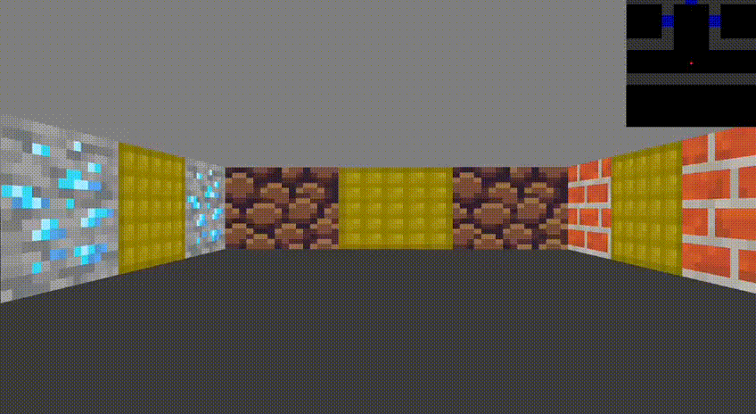

*This project has been created as part of the 42 curriculum by enrmarti* *and* *irkalini.*

#  cub3D

## Desciption

**cub3D** is a 3D first-person maze explorer built entirely in C using the **miniLibX** graphics library. The project uses the mathematical concept of **Raycasting** to render a 3D perspective from a 2D map, replicating the visual style of early 90s classic games like *Wolfenstein 3D* and *Doom*.



---

## Instructions

**Requirements (Linux)**

Since this project uses `minilibx-linux`, you will need to install the required X11 and BSD dependencies before compiling:
```bash
sudo apt-get update
sudo apt-get install gcc make xorg libxext-dev libbsd-dev
```

Compile the mandatory part

```bash
make
```

OR: Compile the bonus version (includes minimap, mouse support, and doors)

```bash
make bonus
```

Run standard map

```bash
./cub3d maps/subject.cub
```

Run a map with bonus features (doors)

```bash
./cub3d maps/bonus.cub
```

---

## Features

* **Raycasting Engine:** Computes 3D graphics on a 2D grid in real-time.
* **Custom Textures:** Different textures for North, South, East, and West facing walls.
* **RGB Parsing:** Parses floor and ceiling colors from `.cub` map files.
* **Collision Detection:** Smooth sliding against walls without clipping.
* **Clean Parsing:** Robust `.cub` file validation and map closure checking.

## Bonus Features

* **Interactive Doors:** Approach a door and press `E` to seamlessly open/close it.
* **Minimap:** A dynamic, scaled minimap rendered in real-time on the HUD.
* **Mouse Camera Control:** Rotate the camera smoothly using mouse movements.
* **Advanced Collisions:** Proper collision handling for doors and map borders.

---

## Resources

### Technologies

* C (C99)
* MiniLibX (graphics library provided by 42)
* X11 (windowing system)
* Raycasting rendering technique
* POSIX System Calls
* Makefile
* Linux / Unix Environment

### AI Usage

AI was used to:

* Explain shell-related concepts and Unix process management.
* Review parsing and execution logic.
* Clarify signal handling behavior.
* Assist with debugging strategies and memory management.
* Improve project documentation.

The final implementation, architecture decisions, debugging, testing, and validation were completed manually.
